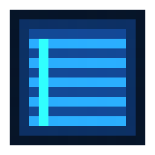

<p align="center">
  
</p>

<h1 align="center">blind</h1>

<p align="center"><em>I can't see my terminal--oh, here it is!</em></p>

Terminal windows get buried under everything else, and each project's tabs and splits are gone once you quit. blind is a macOS terminal that comes down over every app on one key, like a window blind, and goes back up on the same key. Each project lives in its own Session, which comes back with its Tabs, Panes and scrollback after a quit or an OS restart.

## Features

- **Hotkey.** `F12` brings blind down over every app, including fullscreen ones, on every Space. The same key, or clicking away, hides it and gives focus back to the app you were in.
- **Sessions.** One Session per project, each with its own name. `` Cmd+` `` cycles through them, naming each one in the middle of the window as it lands; set `sessionBanner` to `false` to turn that off. The Tab bar shows the Session's label on a row below its Tabs.
- **Restore.** After a quit or an OS restart, every Session comes back with its Tabs, splits, working directories and scrollback, below a "Restored" marker. Shells start fresh.
- **Closed Sessions.** Closing a Session's window keeps the Session, and its Shells keep running, so claude, vim or a build go on in the background. Reopen it from the Command Palette or the menu bar to find each program as you left it, with everything it printed meanwhile. A Pane whose Shell exited meanwhile keeps its output and gets a fresh Shell. Deleting the Session, or quitting, stops its Shells; the quit confirmation names the Closed Sessions still running. Set `session.withoutNameOrRootOnClose` to `delete` to have closing or quitting delete Sessions with neither a name nor a Root directory instead.
- **Tabs and Panes.** Splits nest without limit, and each Tab's title follows the program running in it, or its folder when the Shell is idle. New Tabs start at the Session's Root directory, or the current Pane's directory without one, and new Panes in the split Pane's directory. Set `tab.startDirectory` and `pane.startDirectory` to `root`, `current` or `home` to change that. Renaming a Tab while the Current Pane runs Claude Code suggests Claude Code's Program Title, which follows its `/rename`; set `tab.renameSuggestion` to `all` to suggest any running program's Program Title. Each Pane keeps its text a few pixels off its edges and dividers; set `pane.padding` to `none` to let it run up to them. Panes show no scroll bar; set `pane.scrollBar` to `visible` for a thin one in the Theme's colours.
- **Hidden Tabs.** `Cmd+H`, or the Hide Tab action, takes the Current Tab out of the Tab bar without closing it: its Shells keep running, and the Tab to its right takes its place, or the Tab to its left when it was the rightmost. The Session's last shown Tab can't be hidden. A Hidden Tab is left out of `Cmd+1` to `Cmd+9` and Next and Previous Tab, and shows in italic in the Command Palette and the Activity Sidebar, its Panes too. Choosing it, or one of its Panes, there brings it back as the rightmost Tab; set `hiddenTab.returnPosition` to `original` to bring it back where it was instead. While Hidden Tabs have Activity, the Tab bar counts them after the shown Tabs, such as `+2`. Hidden Tabs stay hidden through Restore.
- **Command Palette.** `Cmd+K` fuzzy-searches every Session, Tab and Pane, and every action. Start the query with `ss`, `tt` or `pp` to search only Sessions, Tabs or Panes. `ss` lists Open Sessions before Closed ones; set `commandPalette.sessionSearchOrder` to `openFirst` or `cycle` to keep that or list them together. `tt` and `pp` search every Open Session; set `commandPalette.tabSearchScope` to `currentSession`, or `commandPalette.paneSearchScope` to `currentSession` or `currentTab`, to search only the Current Session's Tabs, or the Current Session's or Current Tab's Panes. Set `commandPalette.nesting` to `nested` to have the Command Palette, before you type, list each Open Session's Tabs under it and each Tab's Panes under the Tab, or to `hidden` to list only Sessions and actions until you type. Set `commandPalette.kindMarkers` to `true` to mark Sessions, Tabs and Panes with Ⓢ, Ⓣ and Ⓟ before their names, unless `commandPalette.nesting` is `hidden`. Drag the Command Palette by its edge to move it up or down; every Session's window opens it there, even after a restart, until the Reset Command Palette Position action puts it back.
- **Activity.** A Pane whose program asks for your attention while you're elsewhere gets a dot on its Tab and on its Session, Tab and Pane in the Command Palette, until you focus it. The Tab bar names up to three other Sessions with Activity after the Session's name, or shows `3+` past that. Claude Code 2.1.295 and later needs no setup: it reports when it finishes or waits for you (OSC 7501), and blind clears the dot once it gets back to work. Any other program can raise it with a desktop notification (OSC 9, 99 or 777). While blind is hidden, a Pane gaining Activity also plays the Purr sound; set `activity.ring` to `always` to hear it while blind is shown too, or to `never` to turn it off. The Change Activity Sound action picks another macOS sound, playing each one as you move through the list, and sets `activity.sound`. `Cmd+B`, or the Toggle Activity Sidebar action, slides the Activity Sidebar over the right of the window: every Pane with Activity across your Open Sessions, then under their own heading your Closed Sessions, the latest first, under its Session, and under its Tab where two or more Tabs of that Session have Activity. A Closed Session's Activity shows only there, and choosing one of its Panes reopens it. Up, Down and Enter, or a click, jump to one; `Cmd+B` or a click outside closes it. Set `activitySidebar.side` to `left` to have it slide over the left instead.
- **Clickable links.** `Cmd+click` opens URLs and file paths, including relative paths and `path:line:col`.
- **Find in Pane.** `Cmd+F` searches the scrollback and shows the match count.
- **Terminal identity.** Every Shell gets `TERM_PROGRAM=blind`, so programs can tell they're running in blind, even when blind was started from another terminal.
- **Themes.** Five built-in Themes, plus your own `.jsonc` files in `~/.config/blind/themes/`. The picker previews each Theme as you move through the list. The Import Theme action makes one of those files from another terminal's theme: an iTerm2 `.itermcolors`, a Ghostty theme, a Kitty `.conf`, an Alacritty `.toml` or a Windows Terminal colour scheme. It's named after the file, and its Tab bar, Command Palette and Session Banner colours come from the terminal colours.
- **See-through windows.** A Session's window shows its Theme's background 25% transparent over a blur of what's behind it, as iTerm2 does. Set `background.transparency` (0 to 100), `background.blurRadius` (1 to 64), or `background.effect` to `none` for next to no blur. The blur uses a private macOS function ([ADR 0003](docs/adr/0003-blur-through-a-private-macos-api.md)); if a macOS update breaks it, windows show unblurred and blind tells you, once per launch.
- **One config file.** `~/.config/blind/config.jsonc` comes with a schema for editor autocomplete, applies changes as you save, and rebinds any shortcut. Settings are grouped by what they act on, such as `"pane": { "scrollBar": "visible" }`, and this README names them by group and setting joined by a dot, such as `pane.scrollBar` ([ADR 0004](docs/adr/0004-settings-grouped-by-glossary-term.md)).
- **Menu bar icon.** Lists your Open and Closed Sessions, so any of them is one click away.
- **Out of the way.** blind is not in the Dock or `Cmd+Tab`, and starts hidden at login unless `loginLaunch.start` says to start shown.

## Limitations

- The Hotkey can't be changed.
- Only the primary display is used.
- Splits are 50/50 and can't be resized.
- The Tab bar can't be clicked.
- The installed app registers itself as a login item every time it starts.
- Restore doesn't re-run each Pane's last command.

## Install

```sh
npm run install-app
```

Builds `Blind.app` and copies it to `/Applications`, replacing any previous copy. Quit a running Blind and open it again to use the new copy, or use `blind install` (below), which does both.

The installed app:

- uses F12 as the Hotkey, so it can run alongside the development app
- registers itself as a login item and starts hidden at login, until the Hotkey shows it. `loginLaunch.start` in the config file can start it shown instead, and `loginLaunch.withNoOpenSessions` can have a hidden Login Launch with no Open Sessions open one for the first Hotkey press to show
- is ad-hoc signed and not notarized. Built on this Mac, it opens without a Gatekeeper prompt. A copy downloaded from elsewhere would be blocked.

The app icon is made from `build/icon.iconset`. The app registers itself as a login item each time it starts, so removing it from System Settings > General > Login Items lasts only until Blind is next opened.

### The `blind` command

```sh
npm link
```

Run once from the repo, this builds the `blind` command and puts it on your `PATH`. It runs from the repo, so it stays linked to this checkout. If you switch Node versions with a version manager such as nvm, run `npm link` again under the new one.

`blind settings` lists every setting but `keyBindings` with its value and description, each group's under a heading of its name, and changes them as you go: arrow keys move and pick values, and Enter types a number or the `shell` setting. Changes are saved when you quit with `q` or Escape, and a running Blind applies them then; Ctrl+C quits without saving them. Settings changed since the editor opened show in bold yellow with a `*`, and quitting lists them, by group and setting joined by a dot, with their old and new values, under `Discarded:` after Ctrl+C. `blind settings open` opens `~/.config/blind/config.jsonc` in `$EDITOR`, or in its default app without one, creating it first if it's missing.

`blind themes import <file>` makes a Theme file in `~/.config/blind/themes` from an iTerm2, Ghostty, Kitty, Alacritty or Windows Terminal theme, as the Command Palette's Import Theme does, and says where it saved it. It saves the file without showing the Theme first, and refuses a file that isn't a theme, one that leaves out colours the rest are drawn from, and one whose name another Theme or file in the folder has, ignoring case. A running Blind lists the new Theme in Change Theme straight away.

`blind install` runs `npm run install-app`, then asks a running Blind to restart into the new copy: it asks you to confirm, as quitting does, and starts again once you do. Cancel and the old copy keeps running until you next quit. `blind install --force` restarts it without asking, saving your Sessions first. A Blind that isn't running is left that way.

`blind link` runs `npm link` in the repo, which rebuilds the `blind` command first. Run it after changing the command's source. It needs `blind` on your `PATH` already, so the first link, and the one after switching Node versions, is still the one above.

## Develop

```sh
npm install
npm run dev
```

With [the `blind` command](#the-blind-command) linked, `blind dev` does the same as `npm run dev` from any directory. Running from the repo, the Hotkey is F7. The app keeps its data in `~/Library/Application Support/Blind Dev/` and its config and Themes in `~/.config/blind-dev/`, apart from the installed app's, so the two never share Sessions or settings. `dev` and `build` first build the native addon in `native/`, which needs the Xcode Command Line Tools (`xcode-select --install`); the first build downloads Electron's headers.

## Stack

- Electron
- TypeScript
- xterm.js

Why:
- [ADR 0001](docs/adr/0001-electron-and-xterm-js.md) (not Swift or Tauri)
- [ADR 0002](docs/adr/0002-no-background-daemon.md) (no background daemon)
- [ADR 0003](docs/adr/0003-blur-through-a-private-macos-api.md) (blur through a private macOS API)

## Documentation

- [`GLOSSARY.md`](GLOSSARY.md): the domain language. Terms such as Session, Tab, Pane, Hotkey and Restore have precise meanings here.
- [`docs/adr/`](docs/adr): architecture decisions and why they were made.
- [`CONTRIBUTING.md`](CONTRIBUTING.md): commit message conventions and linting.

## Credits

The app and menu bar icons were drawn in [Pixilart](https://www.pixilart.com/).

## License

[MIT](LICENSE)
