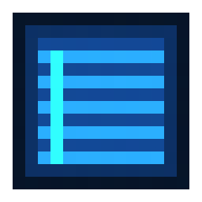

<p align="center">
  
</p>

<h1 align="center">blind</h1>

<p align="center"><em>I can't see my terminal--oh, here it is!</em></p>

Terminal windows get buried under everything else, and each project's tabs and splits are gone once you quit. blind is a macOS terminal that comes down over every app on one key, like a window blind, and goes back up on the same key. Each project lives in its own Session, which comes back with its Tabs, Panes and scrollback after a quit or an OS restart.

## Features

- **Hotkey.** `F12` brings blind down over every app, including fullscreen ones, on every Space. The same key, or clicking away, hides it and gives focus back to the app you were in.
- **Sessions.** One Session per project, each with its own name. `` Cmd+` `` cycles through them, naming each one in the middle of the window as it lands; set `sessionBanner` to `false` to turn that off. The Tab bar shows the Session's name on a row below its Tabs; set `sessionLabelPosition` to `aboveTabs` to show it above them.
- **Restore.** After a quit or an OS restart, every Session comes back with its Tabs, splits, working directories and scrollback, below a "Restored" marker. Shells start fresh.
- **Closed Sessions.** Closing a Session's window keeps the Session. Reopen it from the Command Palette or the menu bar. Set `sessionsWithoutNameOrRootOnClose` to `delete` to have closing or quitting delete Sessions with neither a name nor a Root directory instead.
- **Tabs and Panes.** Splits nest without limit, and each Tab's title follows the program running in it, or its folder when the Shell is idle. New Tabs start at the Session's Root directory, or the current Pane's directory without one, and new Panes in the split Pane's directory. Set `newTabDirectory` and `splitPaneDirectory` to `root`, `current` or `home` to change that.
- **Command Palette.** `Cmd+K` fuzzy-searches every Session, Tab and Pane, and every action. Start the query with `ss`, `tt` or `pp` to search only Sessions, Tabs or Panes. `ss` lists Open Sessions before Closed ones; set `sessionSearchOrder` to `openFirst` or `cycle` to keep that or list them together. `tt` and `pp` search every Open Session; set `tabSearchScope` to `currentSession`, or `paneSearchScope` to `currentSession` or `currentTab`, to search only the Current Session's Tabs, or the Current Session's or Current Tab's Panes.
- **Clickable links.** `Cmd+click` opens URLs and file paths, including relative paths and `path:line:col`.
- **Find in Pane.** `Cmd+F` searches the scrollback and shows the match count.
- **Themes.** Five built-in Themes, plus your own `.jsonc` files in `~/.config/blind/themes/`. The picker previews each Theme as you move through the list.
- **One config file.** `~/.config/blind/config.jsonc` comes with a schema for editor autocomplete, applies changes as you save, and rebinds any shortcut.
- **Menu bar icon.** Lists your Open and Closed Sessions, so any of them is one click away.
- **Out of the way.** blind is not in the Dock or `Cmd+Tab`, and starts hidden at login unless `loginLaunch` says to start shown.

## Limitations

- The Hotkey can't be changed.
- Only the primary display is used.
- Splits are 50/50 and can't be resized.
- The Tab bar can't be clicked.
- The installed app registers itself as a login item every time it starts.
- Restore doesn't re-run each Pane's last command.

## Install

```sh
npm run install-app
```

Builds `Blind.app` and copies it to `/Applications`, replacing any previous copy. Quit a running Blind and open it again to use the new copy.

The installed app:

- uses F12 as the Hotkey, so it can run alongside the development app
- registers itself as a login item and starts hidden at login, until the Hotkey shows it. `loginLaunch` in the config file can start it shown instead, and `hiddenStartWithNoOpenSessions` can have a hidden launch at login with no Open Sessions open one for the first Hotkey press to show
- is ad-hoc signed and not notarized. Built on this Mac, it opens without a Gatekeeper prompt. A copy downloaded from elsewhere would be blocked.

The app icon is made from `build/icon.iconset`. The app registers itself as a login item each time it starts, so removing it from System Settings > General > Login Items lasts only until Blind is next opened.

## Develop

```sh
npm install
npm run dev
```

Running from the repo, the Hotkey is F7.

## Stack

- Electron
- TypeScript
- xterm.js

Why:
- [ADR 0001](docs/adr/0001-electron-and-xterm-js.md) (not Swift or Tauri)
- [ADR 0002](docs/adr/0002-no-background-daemon.md) (no background daemon)

## Documentation

- [`GLOSSARY.md`](GLOSSARY.md): the domain language. Terms such as Session, Tab, Pane, Hotkey and Restore have precise meanings here.
- [`docs/adr/`](docs/adr): architecture decisions and why they were made.
- [`CONTRIBUTING.md`](CONTRIBUTING.md): commit message conventions and linting.

## Credits

The app and menu bar icons were drawn in [Pixilart](https://www.pixilart.com/).

## License

[MIT](LICENSE)
